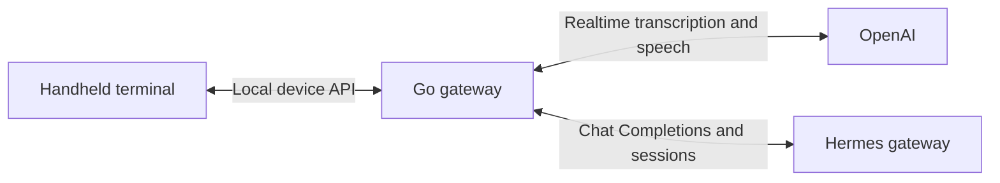

<p align="right">
  <a href="README.zh_CN.md">简体中文</a> · <strong>English</strong>
</p>

# Voice Agent Terminal

A handheld voice-chat terminal with voice drafts reviewed before sending, a Go gateway,
OpenAI transcription and speech, and Hermes Chat Completions.

## Project status

The Go gateway implements mDNS, persistent sessions, side-channel
OpenAI realtime transcription, Hermes Chat Completions, media filtering and
message recovery. Offline adapter tests and a real-binary smoke test exercise
the server workflow. Real OpenAI transcription and two-turn Hermes chat passed
on 2026-11-13 against Hermes 0.23.1. The initial AI Passport firmware implements
sessions, recording, editable drafts and replies. Device tests passed discovery,
recording, appended transcription, sending, reply display and settings navigation.
The current increment adds a voice-first session view, spoken replies that the
gateway synthesizes through the OpenAI Realtime API, a web chat client and device
diagnostic reports; the [roadmap](docs/roadmap.md) records their validation status.
Interaction refinement, workload memory measurements and fault recovery remain open.
The existing [voice-memo](https://github.com/tf4fun/voice-memo) project provides
hardware and reusable server foundations.

## Run the server

Use Go 1.27.3 or later.

```sh
cd server
cp .env.example .env.local
# Fill in OpenAI and Hermes settings in .env.local.
go run ./cmd/voice-agent-server
```

The binary reads the environment file literally. Process variables take
precedence. `/api/v1/health` reports local service health and `/api/v1/server`
reports capabilities. Missing upstream keys leave the corresponding capability
disabled while the local service remains inspectable.

Open the server root in a browser for a web chat client that shares sessions
and replies with the device (drafts stay on each client); deleting a session there also removes it
from Hermes. See [server configuration and API](docs/server.md) for request examples.

## Validate and build

```sh
cd server
go vet ./...
go test -race ./...
cd ..
./tools/smoke-server.sh
node tools/test-web.mjs
./tools/build-server.sh amd64
./tools/build-server.sh arm64
./tools/test-firmware-host.sh
./tools/ui-preview.sh
```

The firmware host tests need only a C compiler and Python 3. `tools/ui-preview.sh`
downloads the locked LVGL version once and renders the device screens into
`build/ui-preview/frames/`.
Building and flashing the firmware with ESP-IDF 5.5.3 is described in the
[firmware guide](docs/firmware.md#build-and-validation).

GitHub Actions runs the server checks and builds static Linux AMD64 and ARM64
binaries with SHA-256 checksums. A separate ESP-IDF 5.5.3 job builds and verifies
the ESP32-C3 firmware. Artifacts are attached to successful runs. Pushing a
`v*` tag runs both builds and publishes the full firmware image, both server
binaries and a combined `SHA256SUMS` as GitHub release assets.

## Interaction

1. Hold OK to record a thought and watch its live transcription.
2. Review the transcript in the draft panel. Hold OK again to re-record it.
3. Short-press OK to send the reviewed text directly in the selected session.
4. Watch the thinking animation. Once Hermes has finished, the device reads the
   reply aloud (when the gateway offers speech) and the text card shows it from
   its beginning.

The device keeps one pending message in RAM, bounded to 140 characters and
shown with its count. A successful re-recording replaces its earlier text, and
long Down clears it. Transcription is a side channel: the gateway returns the
text and stores nothing. Sending carries the complete text as an immutable
message snapshot; a new session is created and titled by its first send, so
abandoned recordings leave no empty sessions. An unsent draft does not delay
sleep; deep sleep or a reboot loses it. The user's
send action triggers Hermes.

## Architecture



- The Go gateway advertises itself through mDNS and provides the device API.
- OpenAI supplies streaming transcription. `gpt-live-transcribe` is the initial
  candidate from the official guidance checked on 2026-11-13. The gateway also
  uses the OpenAI Realtime API to read completed replies aloud.
- Hermes manages conversation history and serves Chat Completions through its
  existing API.
- Go manages the device's session list, message identities, filtered
  reply cache, and reconnect recovery.
- The device uses bounded audio and text buffers. Media filtering happens in Go.

AI Passport, with ESP32-C3 and no PSRAM, is the initial validation device.
Future hardware may use ESP32-S3 with PSRAM. The first firmware uses online PCM16
streaming with bounded buffers. Button mappings and device acceptance are
described in the firmware guide.

## Documentation

- [Firmware, controls and validation](docs/firmware.md)
- [Architecture and data ownership](docs/architecture.md)
- [Milestones and acceptance](docs/roadmap.md)
- [Server configuration and API](docs/server.md)
- [Agent contribution instructions](AGENTS.md)

## References

- [OpenAI realtime transcription](https://developers.openai.com/api/docs/guides/realtime-transcription)
- [Hermes API server](https://hermes-agent.nousresearch.com/docs/user-guide/features/api-server/)
- [AI Passport hardware and firmware reference](https://github.com/FoloToy/ai-passport)

Provider availability, session continuation, retry behavior, microphone latency,
and device memory usage require integration tests against the selected versions.

## License and reuse

This project follows the MIT license retained in [LICENSE](LICENSE).
[NOTICE](NOTICE) records the server foundations adapted from voice-memo and
its FoloToy/ai-passport lineage.
