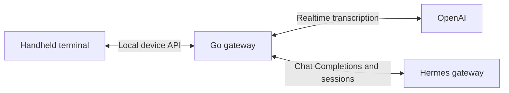

  <a href="README.zh_CN.md">简体中文</a> · <strong>English</strong>

# Voice Agent Terminal

A handheld voice-chat terminal with editable message drafts, a Go gateway,
OpenAI transcription, and Hermes Chat Completions.

## Project status

This repository starts with the agreed product requirements and architecture.
Gateway implementation, device firmware, and integration validation are upcoming
milestones. The existing [voice-memo](https://github.com/tf4fun/voice-memo)
project provides hardware and implementation references.

## Interaction

1. Record a thought and view streaming transcription in a draft segment.
2. Review the draft, record additional segments, and delete unwanted segments.
3. Explicitly send the visible draft as one text message in the selected session.
4. Read the streamed reply and continue the conversation.

Each recording creates an independently editable draft segment. Sending commits
the reviewed draft revision as an immutable message snapshot. Transcription
completion updates the editable draft; the user's send action triggers Hermes.

## Architecture

- The Go gateway advertises itself through mDNS and provides the device API.
- OpenAI supplies streaming transcription. `gpt-live-transcribe` is the initial
  candidate from the official guidance checked on 2026-11-13.
- Hermes manages conversation history and serves Chat Completions through its
  existing API.
- Go manages the device's session list, drafts, message identities, filtered
  reply cache, and reconnect recovery.
- The device uses bounded audio and text buffers. Media filtering happens in Go.

AI Passport, with ESP32-C3 and no PSRAM, is the initial validation device.
Future hardware may use ESP32-S3 with PSRAM. Audio transport, encoding, memory
budgets, and final button mappings remain design and measurement work.

## Documentation

- [Architecture and data ownership](docs/architecture.md)
- [Milestones and acceptance](docs/roadmap.md)
- [Agent contribution instructions](AGENTS.md)

## References

- [OpenAI realtime transcription](https://developers.openai.com/api/docs/guides/realtime-transcription)
- [Hermes API server](https://hermes-agent.nousresearch.com/docs/user-guide/features/api-server/)
- [AI Passport hardware and firmware reference](https://github.com/FoloToy/ai-passport)

Provider availability, session continuation, retry behavior, microphone latency,
and device memory usage require integration tests against the selected versions.
