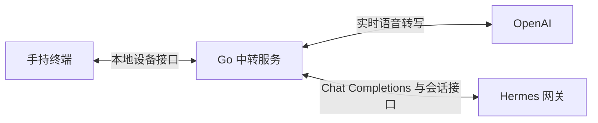

<p align="right">
  <strong>简体中文</strong> · <a href="README.md">English</a>
</p>

# Voice Agent Terminal

一个支持发送前编辑草稿的手持语音聊天终端，通过 Go 中转服务连接
OpenAI 语音转写和 Hermes Chat Completions。

## 项目状态

Go 服务已实现 mDNS、持久化会话与可编辑草稿、OpenAI 实时转写、Hermes
Chat Completions、媒体过滤和消息恢复。离线上游适配测试和真实二进制烟雾
测试覆盖服务端流程。2026-11-13 已通过真实 OpenAI 转写和 Hermes 0.23.1
两轮会话测试。首版 AI Passport 固件已实现会话、录音、草稿和回复，设备实测通过
服务发现、录音、追加转写、发送、回复显示及设置切换。交互优化、负载内存测量及
故障恢复验证继续进行。现有 [voice-memo](https://github.com/tf4fun/voice-memo)
项目提供硬件参考和可复用的服务端基础。

## 启动服务

使用 Go 1.27.3 或更新版本。

```sh
cd server
cp .env.example .env.local
# 在 .env.local 中填写 OpenAI 与 Hermes 配置。
go run ./cmd/voice-agent-server
```

程序按字面值读取环境文件，进程环境变量优先。`/api/v1/health` 返回本地服务
健康状态，`/api/v1/server` 返回能力声明。上游密钥缺失时，对应能力显示为禁用，
本地服务仍可检查。

在浏览器打开服务根地址，可查看会话列表、预览对话，并删除不需要的会话，
同步移除 Hermes 中对应的会话。请求示例见 [服务端配置与接口](docs/server.zh_CN.md)。

## 验证与构建

```sh
cd server
go vet ./...
go test -race ./...
cd ..
./tools/smoke-server.sh
./tools/build-server.sh amd64
./tools/build-server.sh arm64
```

GitHub Actions 运行服务端检查，构建静态 Linux AMD64 和 ARM64 二进制，
并生成 SHA-256 校验文件。独立的 ESP-IDF 5.5.3 任务构建并校验 ESP32-C3
固件。成功工作流附带对应构建产物。

## 交互流程

1. 录下一段想法，在草稿段落中查看实时转写。
2. 在对话页检查转写，长按 OK 可以重新录制。
3. 短按 OK 直接将审阅过的文字发送到选中的会话。
4. 等待动画结束后，从开头阅读完整回复，继续对话。

设备保留一条待发送消息，重录成功后替换此前的文字。发送时，将用户审阅的草稿
版本固定为消息快照。中转服务继续提供通用的段落编辑接口。转写完成用于更新
草稿，Hermes 调用由用户的发送动作触发。

## 架构



- Go 服务通过 mDNS 广播自身地址，向设备提供统一接口。
- OpenAI 提供实时转写。根据 2026-11-13 查阅的官方文档，首个候选模型为
  `gpt-live-transcribe`。
- Hermes 负责对话历史，通过已有 API 提供 Chat Completions。
- Go 管理设备会话列表、草稿、消息标识、过滤后的回复缓存和断线恢复。
- 设备使用有上限的音频与文字缓冲，媒体过滤由 Go 承担。

首个验证设备为 ESP32-C3、无 PSRAM 的 AI Passport。后续硬件可采用
ESP32-S3 与 PSRAM。首版固件采用联网 PCM16 流式传输与有界缓冲，按键映射和设备验收见固件文档。

## 文档

- [固件、按键与验证](docs/firmware.zh_CN.md)
- [架构与数据归属](docs/architecture.zh_CN.md)
- [里程碑与验收](docs/roadmap.zh_CN.md)
- [服务端配置与接口](docs/server.zh_CN.md)
- [AI 协作说明](AGENTS.zh_CN.md)

## 参考资料

- [OpenAI 实时转写](https://developers.openai.com/api/docs/guides/realtime-transcription)
- [Hermes API 服务](https://hermes-agent.nousresearch.com/docs/user-guide/features/api-server/)
- [AI Passport 硬件与固件参考](https://github.com/FoloToy/ai-passport)

模型权限、会话续接、重试行为、麦克风延迟和设备内存占用，都需要针对选定版本进行集成验证。

## 许可与复用

项目沿用 [LICENSE](LICENSE) 中保留的 MIT 许可。[NOTICE](NOTICE) 记录
从 voice-memo 及其 FoloToy/ai-passport 来源适配的服务端基础。
